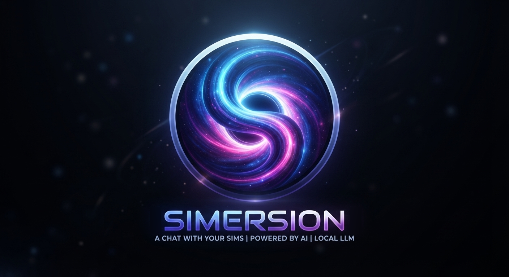
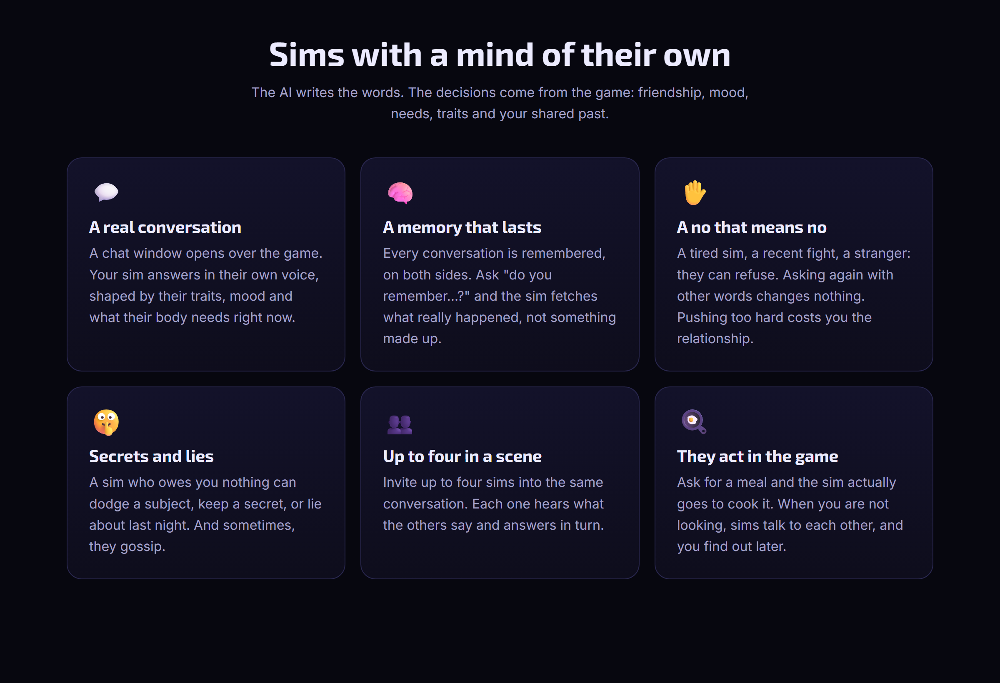
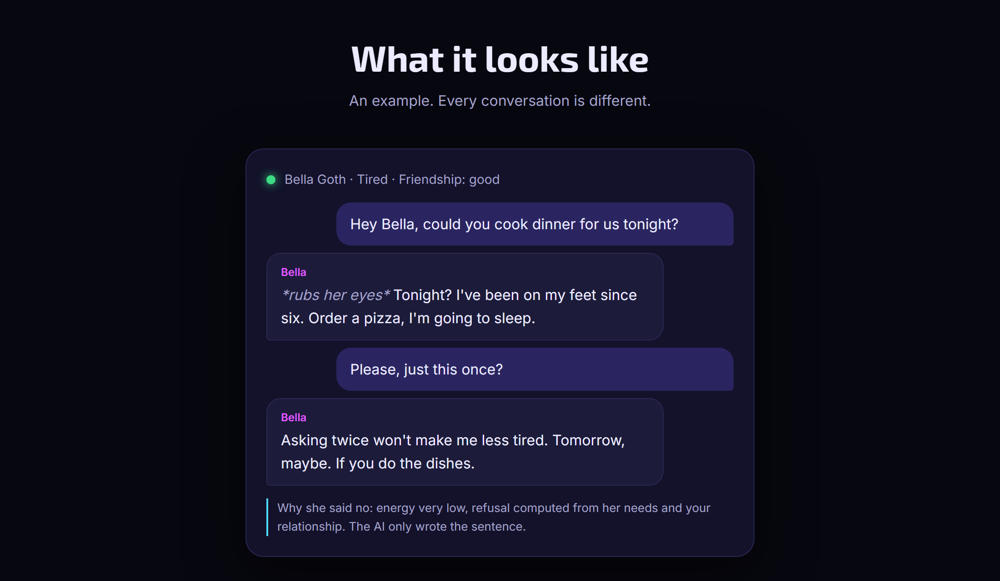
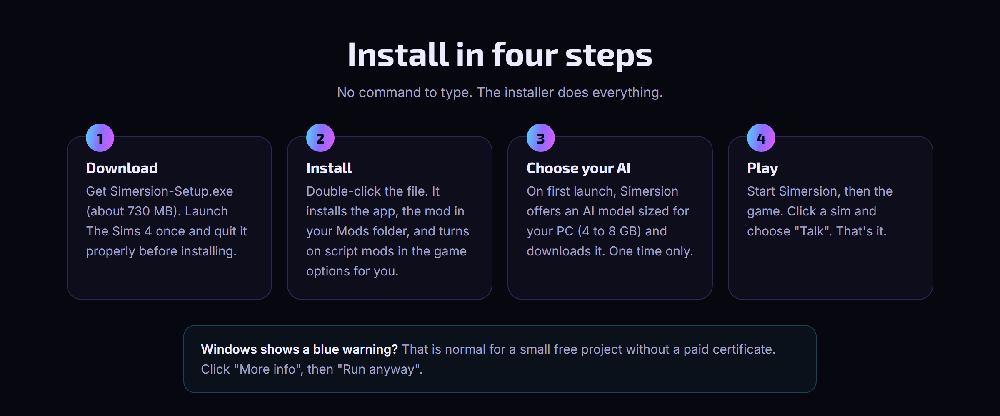

  

<h3 align="center">Talk to your Sims. For real.</h3>

  A free mod for The Sims 4. Click a sim, write to them, and they answer as themselves: 
  their traits, their mood, their memories of you. They can agree, refuse, or lie.

  
  &nbsp;
  
  &nbsp;
  

  
  
  
  

---

## ✨ Sims with a mind of their own

  

## 💬 What it looks like

  

An illustrated example. Every conversation is different.

## 📥 Install

  

1. **[Download `Simersion-Setup.exe`](https://github.com/BigBlackC0de/Simersion-Download/releases/latest/download/Simersion-Setup.exe)** (about 730 MB).
2. Launch The Sims 4 once and quit it properly.
3. Double-click the file. It installs the app and the mod, and turns on script mods for you.
4. On first launch, pick an AI model sized for your PC (4 to 8 GB). Then start the game, click a sim and choose **Talk**.

> [!NOTE]
> **Windows or your antivirus shows a warning?** That is normal for a small project without a paid certificate. Click **More info**, then **Run anyway**. For Avast, AVG, Norton or your browser, and to check that your file is the real one: **[Is it safe?](https://simersion.pages.dev/#safety)**

## 🖥️ What your PC needs

The AI runs on your own graphics card. That is why it is private, and why it needs a decent PC.

| | |
|---|---|
| **System** | Windows 10 or 11, 64-bit |
| **Game** | The Sims 4, up to date. No pack required. |
| **Graphics card** | 8 GB of video memory recommended. 6 GB works with the lighter model. |
| **Memory** | 16 GB of RAM recommended |
| **Disk space** | About 10 GB free (app + AI model) |
| **Internet** | Only for the download. Then everything works offline. |

## ❓ Questions

<b>Is it free?</b>

 
Yes. No account, no subscription, no ads. If you like it, you can support the project on <a href="https://ko-fi.com/azsra">Ko-fi</a>.

<b>Are my conversations sent somewhere?</b>

 
No. The AI runs on your PC. Nothing is sent to a server, there is no tracking, and Simersion works without internet once installed.

<b>Can I stream or record with it?</b>

 
Yes. Simersion stays at the level of the base game: romance and WooHoo are understood, never shown or described.

<b>Will it break my save?</b>

 
No. Simersion does not change your save files. Its memories are kept in a separate folder. Remove the mod and your game is exactly as before.

<b>What languages does it speak?</b>

 
French and English. Pick your language in the app and your sims answer in it.

<b>Is there a Mac version?</b>

 
Not yet. Simersion is Windows only for now.

## 🐛 Found a bug?

[Open an issue](https://github.com/BigBlackC0de/Simersion-Download/issues/new/choose). The **Diagnostics** button in the Simersion app makes a zip of the logs on your Desktop: attach it to your report.

## ❤️ Support

Simersion is made by one person, on free time. If your sims made you laugh, a coffee helps me keep going and add new things.

  

---

This repository only hosts the installer. 
Simersion is a free fan-made mod. It is not made, endorsed or supported by Electronic Arts or Maxis. The Sims is a trademark of Electronic Arts Inc.

